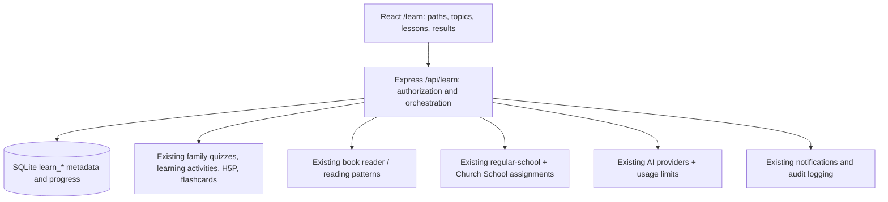

FamilyHub Learn — Architecture and Codex Build Contract
Status: Approved product direction; architecture proposal, not implemented.
Repo: Thugney/trace
Review baseline: feature/quiz @ 36d1721dce34fb4964fdb78494f8d296423c826e (March 28, 2026). main/dev are behind it; August 2026 codex/complete-psalm-51 adds separate Bible content. Confirm the active integration branch and reconcile divergence before coding; never overwrite or blindly merge.
1. Outcome and scope
Build FamilyHub Learn inside the existing PWA, not as a separate website. Start with Norwegian 8. trinn (Mathematics, Norwegian, English, Science, Social Studies). Data and routing must support grades 1–10 later. Content follows LK20/Udir. A learner can follow a sequenced course or select any subject/topic before a test. Parents assign work and monitor progress; existing Church School stays independent.

Learner journey: Select grade/subject → topic → reviewed article with worked examples → optional AI tutor → existing flashcards / interactive exercises / quizzes → practice feedback → optional mock exam → indicative 1–6 grade with evidence and next steps.

Do not rebuild the existing learning engines, school management, book library, user profiles, gamification or notification infrastructure.
2. Architecture and ownership

Existing source	Reuse, do not duplicate
backend/src/routes/school.ts, regular-school.ts, frontend/src/pages/School.tsx	Parent/teacher assignment workflows, classes, submissions, feedback; preserve Church School semantics
family-quizzes.ts, activities.ts, h5p.ts and frontend/src/components/activities/FlashcardsActivity.tsx	Question delivery, H5P content, flashcards and scored attempts; introduce adapters, not another quiz engine
books.ts, BookReader.tsx	Reading UX and progress concepts; lessons have their own LK20 content model
ai.ts, aiUsageControl.ts	Model/provider integration, parental controls, quotas; add a lesson-grounded tutor, not a second AI stack
profileFeatures.ts, feature-access.ts, familyAccess.ts, notifications.ts	Feature gating, family scoping, notices and audited actions

New surfaces: /learn (student), /learn/parent (guardian), optional teacher links within the existing School UI. New backend router /api/learn and small learn service modules. Do not add Learn inside the ~2,400-line School.tsx page.
3. LK20 source of truth
- Each topic and lesson has: grade, subject, language, Udir curriculum code, linked official competence goal(s), goal assessed after grade, source URL, curriculum revision, reviewed_by, reviewed_at and content version.
- Distinguish local grade-8 teaching sequences from official goals: Mathematics has goals after grade 8; Science, Norwegian, English and Social Studies commonly map grade-8 content to goals after grade 10. Never present local sequencing as an official Udir grade-8 goal.
- Maintain a small reviewed, versioned lesson library. AI may explain, adapt reading level or generate draft practice; AI output must not silently become authoritative curriculum material.
- Start with Bokmål, and English instructional material for English. Support locale expansion without changing IDs. Attribute Udir and link to sources; do not bulk-copy third-party textbook content.
Official references: Mathematics MAT01-05, grade 8; Science NAT01-04, grade 10; Norwegian NOR01-06, grade 10; Udir assessment.
4. Minimal additive data model
Create learn_* tables with FK indexes, uniqueness constraints, migrations and audit events; reuse existing IDs rather than copying attempts or quiz content.
Entity	Minimum fields / invariant
learn_subjects	id, slug, title, udir_code (one subject definition across grades)
learn_goals	id, subject_id, official_goal_ref (if published; otherwise versioned source locator), goal_level, source_url, curriculum_revision
learn_topics	id, subject_id, grade, slug, sort_order, prerequisite_topic_id (course order and free-topic catalog)
learn_topic_goals	Unique (topic_id, goal_id) mapping; do not invent official goals
learn_lessons	id, topic_id, slug, sort_order, locale, version, body, review_status, reviewed_by, reviewed_at
learn_resource_links	lesson_id, kind (quiz, activity, h5p, flashcards), existing_resource_id; check resource access on every fetch
learn_progress	Unique (profile_id, lesson_id), state, timestamps; scored results must come from verified existing-engine attempts, not client-reported marks
learn_assignments	assigned_by, child_id or authorized class_id, lesson/topic/exam ref, due_at, state; enforce family/class scope
learn_mock_exams, learn_mock_attempts	Subject/topic, rubric + version, evidence, attempt owner, completed timestamp, indicative grade or insufficient_evidence
learn_flashcard_reviews	profile_id, existing deck/card reference, known/missed rating, reviewed_at, next_due_at; user edits/forks never modify curated shared content

Keep existing school_*, regular_school_*, learning_sessions, family_quiz_*, h5p_* and book tables intact. Add only migrations actually required by completed vertical slices.
5. Proposed API contract (subject to existing naming conventions)
- GET /api/learn/catalog?grade=8 → subjects, paths and free topics; GET /api/learn/topics/:id, GET /api/learn/lessons/:id → reviewed lesson and owned resource references.
- GET /api/learn/me/progress → current signed-in learner; GET /api/learn/children/:id/progress → linked parent or authorized admin only.
- POST /api/learn/assignments → guardian→own child, teacher→assigned class only, with audit and idempotency key.
- POST /api/learn/mock-exams/:id/start and POST /api/learn/mock-attempts/:id/submit → server-created attempt, verified actor, server-scored rubric.
- POST /api/learn/tutor → lesson-scoped help, selected reviewed content only; disabled server-side during mock exams.
- Link practice exercises by existing APIs and immutable attempt IDs. Score reconciliation is server-to-server/service-side; never trust learner-submitted percentages. Idempotent submissions must not award points twice on retries or duplicate xAPI events.
6. Assessment, AI and child safety
- Practice: show explanations, hints, mastery and next topics. Mock exams only: optional indicative Norwegian grade 1–6, rubric evidence, limitations and improvement feedback. Never label as an official or predicted standpunktkarakter. If evidence or rubric coverage is insufficient, show insufficient_evidence, not a fabricated grade. Require parent/teacher review for subjective/open-ended work.
- AI is contextual and child-safe: lesson grounding, no answer dumping, no curriculum fabrication, no autonomous publishing, quotas and provider-failure fallback. Avoid transmitting unrelated child profiles, school rosters or private notes to AI providers. Treat lesson/user text as untrusted prompt input.
- RBAC must be enforced by the API: child=self, guardian=linked children, teacher=assigned class, admin=audited; no cross-family or cross-class lookup, direct-object ID attacks or leaderboard data leakage. Use anonymized/opt-in school leaderboards, not academic rankings by default.
- School identity is unresolved: the two church schools might be separate organizations rather than classes. Do not merge them, infer organization membership, expose pooled rosters or ship cross-school comparisons until the organization boundary is confirmed. Family-only Learn MVP may proceed without coupling to Church School enrollment.
7. Mandatory security and compatibility gate (before child pilot)
1. Replace backend/src/middleware/auth.ts trust in x-profile-id/query ID with a server-verifiable authenticated session (secure HttpOnly cookie or signed token), request identity derived server-side, and protected session lifecycle. Fix unauthenticated, string-compared verify-pin / set-pin in profiles.ts; migrate legacy PIN values safely.
2. Enforce parent-child ownership in H5P assignments, quiz/activities, every progress read and each new Learn endpoint. Add negative authorization tests.
3. Reconcile School frontend API calls to /submissions/:id/grade, /submissions/ungraded, /leaderboard, /students/:id/stats with actual backend contracts; do not assume those endpoints are implemented.
4. Introduce learn in existing feature keys/permissions. Fix school_only_mode so authorized school-only profiles can use specifically allowed learning components without unrestricted access to FamilyHub core modules.
5. Preserve all existing saved quizzes/H5P content, Church School assignments/submissions, Regular School homework and points. Test old and new records, especially after Synology rebuilds.
8. Codex delivery sequence and acceptance
1. Preflight: Fetch all refs; confirm integration base; document branch differences; inventory routes/schema/tests and relevant production Synology runbook. Do not auto-merge. Create an implementation branch only from an explicitly selected base.
2. Security/compatibility PR: Complete the gates above with focused regression tests. No Learn rollout until these pass.
3. Catalog PR: Add idempotent schema and learn feature flag (default off), reviewed grade-8 Udir subject/goal/topic fixtures, read-only catalog and lesson APIs.
4. Learning PR: Build /learn for course-order + free topics, article/examples, existing exercise/flashcard/H5P adapters; persist per-child progress and editable personal decks.
5. Assessment/parent PR: Parent assignments and child progress, deterministic mock exam rubric and non-official 1–6 estimates; contextual AI tutor with strict exam lockout.
6. Pilot: Deliver at least one fully reviewed, end-to-end grade-8 topic per initial subject, then widen topic coverage. Validate accessibility, phones/iPads, light/dark theme, and Norwegian/English copy.
Acceptance checklist: backend tests/build + frontend build/lint; new Vitest API/security tests; idempotent retries and xAPI duplicate-event tests; end-to-end parent→child assignment→read→practice→mock exam→feedback; test Family A/B, teacher, admin, unauthorized and cross-family attempts; old Quiz/H5P/School/Books regression; stable progress after reload; AI disabled during exams and when parent disables it; no false grade when rubric evidence is insufficient. Report failed baseline checks instead of hiding them.

Operations and rollback: Docker/Synology runbook; backup SQLite and uploads/H5P assets before migration; additive, repeat-safe migrations; audit actor/action/object/timestamp without unnecessarily logging child answers; feature off by default, opt-in parent pilot; monitor errors, provider costs and scoring anomalies; rollback by switching off learn and reverting application image. Do not drop migrated tables or erase learner history on rollback.
9. Non-goals and decisions remaining
Not in first release: a second LMS, school timetable integration, automatic Udir content ingestion without review, official school grading, public student leaderboards, and a new quiz engine. Pending before church-school integration: whether the two church schools represent separate organizations with independent data partitions. This decision does not block the family-only grade-8 pilot.

Codex instruction: Treat this file as the source of truth for FamilyHub Learn scope and implementation gates. Work incrementally, prove reuse, submit small reviewable PRs with tests and rollback notes. Do not interpret this architecture document as permission to deploy or merge application changes.
